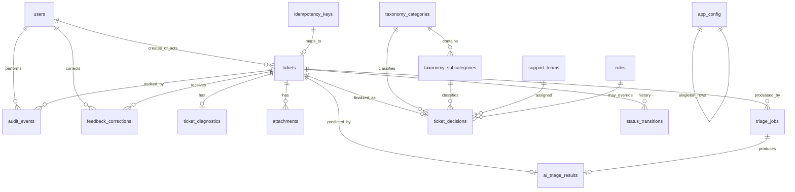

# Data Model — AI Ticket Triage POC

**Document version:** 0.1  
**Status:** POC logical schema  
**Last updated:** 2026-10-03  
**Parent design:** [system_design.md](./system_design.md)  
**Source requirements:** [requirements.md](./requirements.md) §4.4, FR-FBK-*, FR-AUD-*, FR-TKT-005

---

## 1. Design Goals

1. Persist customer content, diagnostics, AI predictions, and human decisions as **separately recoverable** facts (FR-TKT-005, FR-FBK-001).
2. Support transactional ticket creation before AI (FR-TKT-003).
3. Enable queue filters/search and reviewed-only evaluation metrics (FR-QUE-*, FR-ANL-002).
4. Record audit and correction metadata for every consequential change (FR-AUD-*, FR-FBK-002).
5. Manage schema via Alembic migrations (NFR-MNT-003).

PostgreSQL is the system of record. Attachment **binaries** live in MinIO; the database stores metadata only.

---

## 2. Logical ERD



---

## 3. Provenance Model

Every displayed field belongs to one provenance class:

| Provenance | Storage | UI treatment |
|---|---|---|
| `customer` | `tickets.subject`, `tickets.message` | Original content panel |
| `diagnostics` | `ticket_diagnostics.*` | Metadata panel, labeled system/client |
| `ai` | `ai_triage_results.*` | Inference panel; never presented as fact |
| `rule` | finals with `*_source = rule` | Shown as system rule override |
| `human` | `ticket_decisions` after agent edit + `feedback_corrections` | Final decision panel |

AI predictions are **immutable** after a successful triage persist. Human edits update `ticket_decisions` and append `feedback_corrections`.

---

## 4. Enumerations

```text
ticket_status: NEW | TRIAGING | NEEDS_REVIEW | OPEN | IN_PROGRESS | RESOLVED | CLOSED
priority: P0 | P1 | P2 | P3
decision_source: ai | rule | human
actor_type: system | worker | agent | admin | mobile
triage_job_status: pending | running | succeeded | failed | dead_letter
platform: ios | android
user_role: agent | admin | mobile
```

---

## 5. Tables

### 5.1 `users`

Support agents/admins (and optional POC mobile test identities).

| Column | Type | Notes |
|---|---|---|
| `id` | UUID PK | |
| `email` | CITEXT UNIQUE | |
| `display_name` | TEXT | |
| `role` | ENUM `user_role` | `agent` \| `admin` \| `mobile` |
| `password_hash` | TEXT NULL | Local POC auth; null if external IdP later |
| `is_active` | BOOLEAN | default true |
| `created_at` | TIMESTAMPTZ | |
| `updated_at` | TIMESTAMPTZ | |

### 5.2 `idempotency_keys`

| Column | Type | Notes |
|---|---|---|
| `id` | UUID PK | |
| `principal_id` | UUID/TEXT | Authenticated mobile principal |
| `key` | TEXT | Client `Idempotency-Key` |
| `request_hash` | TEXT | Optional hash of normalized body |
| `ticket_id` | UUID FK → tickets | |
| `created_at` | TIMESTAMPTZ | |
| UNIQUE | (`principal_id`, `key`) | AC-002 |

### 5.3 `tickets`

| Column | Type | Notes |
|---|---|---|
| `id` | UUID PK | Internal ID |
| `public_id` | TEXT UNIQUE | e.g. `T-1042` (FR-TKT-002) |
| `status` | ENUM `ticket_status` | default `NEW` |
| `subject` | TEXT NULL | customer |
| `message` | TEXT NOT NULL | customer |
| `created_by_principal` | TEXT | mobile user/app id |
| `created_at` | TIMESTAMPTZ | immutable create time |
| `updated_at` | TIMESTAMPTZ | |
| `reviewed_at` | TIMESTAMPTZ NULL | set on first agent approve/correct |
| `reviewed_by_user_id` | UUID NULL FK → users | |
| `retain_until` | TIMESTAMPTZ NULL | NFR-PRV-003 |

Indexes: `(status, created_at DESC)`, `(created_at DESC)`, `GIN`/`pg_trgm` on `message`/`subject` for search (POC may start with `ILIKE` + btree on `public_id`).

### 5.4 `ticket_diagnostics`

1:1 with ticket; allowlisted fields only (FR-TKT-004).

| Column | Type | Notes |
|---|---|---|
| `ticket_id` | UUID PK FK → tickets | |
| `platform` | ENUM NULL | ios \| android |
| `app_version` | TEXT NULL | |
| `os_version` | TEXT NULL | |
| `device_model` | TEXT NULL | |
| `locale` | TEXT NULL | |
| `timezone` | TEXT NULL | |
| `current_screen` | TEXT NULL | |
| `account_tier` | TEXT NULL | |
| `session_id` | TEXT NULL | |
| `recent_error_codes` | TEXT[] | default `{}` |
| `diagnostics_opt_in` | BOOLEAN NULL | product consent signal if provided |
| `raw_extra` | JSONB NULL | **not** forwarded to LLM by default; rejected or ignored for unknown keys at API |

Provenance: `diagnostics`.

### 5.5 `attachments`

| Column | Type | Notes |
|---|---|---|
| `id` | UUID PK | |
| `ticket_id` | UUID FK → tickets | |
| `filename` | TEXT | |
| `content_type` | TEXT | validated image types for POC |
| `size_bytes` | BIGINT | max size enforced |
| `storage_bucket` | TEXT | |
| `storage_key` | TEXT | MinIO object key |
| `created_at` | TIMESTAMPTZ | |

No binary blob columns.

### 5.6 `taxonomy_categories` / `taxonomy_subcategories`

| `taxonomy_categories` | Type | Notes |
|---|---|---|
| `id` | UUID PK | |
| `code` | TEXT UNIQUE | e.g. `ACCOUNT`, `BILLING` |
| `name` | TEXT | |
| `is_active` | BOOLEAN | FR-TAX-003 |
| `created_at` / `updated_at` | TIMESTAMPTZ | |

| `taxonomy_subcategories` | Type | Notes |
|---|---|---|
| `id` | UUID PK | |
| `category_id` | UUID FK | |
| `code` | TEXT | unique per category |
| `name` | TEXT | |
| `is_active` | BOOLEAN | |
| UNIQUE | (`category_id`, `code`) | |

AI may only persist codes that exist and are active (FR-TAX-001).

### 5.7 `support_teams`

| Column | Type | Notes |
|---|---|---|
| `id` | UUID PK | |
| `code` | TEXT UNIQUE | e.g. `billing_support` |
| `name` | TEXT | |
| `is_active` | BOOLEAN | |
| `created_at` / `updated_at` | TIMESTAMPTZ | |

### 5.8 `triage_jobs`

| Column | Type | Notes |
|---|---|---|
| `id` | UUID PK | correlation id |
| `ticket_id` | UUID FK → tickets | |
| `status` | ENUM `triage_job_status` | |
| `attempt_count` | INT | |
| `max_attempts` | INT | from config |
| `celery_task_id` | TEXT NULL | |
| `last_error` | TEXT NULL | |
| `started_at` | TIMESTAMPTZ NULL | |
| `finished_at` | TIMESTAMPTZ NULL | |
| `created_at` | TIMESTAMPTZ | |
| `updated_at` | TIMESTAMPTZ | |

Indexes: `(status, created_at)`, `(ticket_id)`. Partial unique index: one non-terminal active job per ticket for POC simplicity (`WHERE status IN ('pending','running')`).

### 5.9 `ai_triage_results`

Immutable successful (or last attempted structured) AI prediction. Prefer **one current row per ticket** (`ticket_id` UNIQUE) plus optional history table later; failed attempts may store error on `triage_jobs` only.

| Column | Type | Notes |
|---|---|---|
| `id` | UUID PK | |
| `ticket_id` | UUID UNIQUE FK | |
| `triage_job_id` | UUID FK → triage_jobs | |
| `summary` | TEXT | |
| `category_code` | TEXT | validated |
| `subcategory_code` | TEXT | validated |
| `priority` | ENUM `priority` | AI-recommended |
| `recommended_team_code` | TEXT | AI-recommended |
| `sentiment` | TEXT NULL | |
| `tags` | TEXT[] | normalized |
| `likely_cause` | TEXT NULL | inference; may be null |
| `diagnosis_confidence` | NUMERIC(4,3) NULL | 0–1 |
| `suggested_actions` | JSONB | string array |
| `suggested_reply` | TEXT | draft only |
| `confidence_category` | NUMERIC(4,3) | 0–1 |
| `confidence_priority` | NUMERIC(4,3) | |
| `confidence_routing` | NUMERIC(4,3) | |
| `provider` | TEXT | |
| `model` | TEXT | |
| `prompt_version` | TEXT | |
| `latency_ms` | INT | |
| `input_tokens` | INT NULL | |
| `output_tokens` | INT NULL | |
| `estimated_cost_usd` | NUMERIC(12,6) NULL | |
| `raw_response` | JSONB NULL | restricted retention |
| `created_at` | TIMESTAMPTZ | |

Application must not UPDATE prediction columns after insert (enforce in repository layer).

### 5.10 `ticket_decisions`

Current governed finals (AI + rules + human). Separated so AI row remains pristine.

| Column | Type | Notes |
|---|---|---|
| `ticket_id` | UUID PK FK → tickets | |
| `summary` | TEXT NULL | usually from AI unless human edits summary later (POC: copy AI) |
| `category_code` | TEXT | |
| `subcategory_code` | TEXT | |
| `priority` | ENUM `priority` | |
| `priority_source` | ENUM `decision_source` | `ai` \| `rule` \| `human` |
| `assigned_team_code` | TEXT | |
| `routing_source` | ENUM `decision_source` | |
| `recommended_team_code` | TEXT | copy of AI recommendation for metrics (FR-RTE-003) |
| `tags` | TEXT[] | |
| `suggested_reply` | TEXT | agent-editable draft |
| `applied_rule_id` | UUID NULL FK → rules | |
| `classification_source` | ENUM `decision_source` | category/subcategory source |
| `updated_at` | TIMESTAMPTZ | |
| `updated_by_user_id` | UUID NULL | |

Indexes: `(priority)`, `(assigned_team_code)`, `(category_code)` for queue filters.

### 5.11 `feedback_corrections`

| Column | Type | Notes |
|---|---|---|
| `id` | UUID PK | |
| `ticket_id` | UUID FK | |
| `field_name` | TEXT | e.g. `category`, `priority`, `assigned_team`, `tags` |
| `ai_value` | JSONB | original AI value |
| `human_value` | JSONB | corrected value |
| `agent_user_id` | UUID FK → users | |
| `created_at` | TIMESTAMPTZ | |

Approval without changes:

### 5.12 `triage_approvals`

| Column | Type | Notes |
|---|---|---|
| `id` | UUID PK | |
| `ticket_id` | UUID FK | |
| `agent_user_id` | UUID FK | |
| `approved_unchanged` | BOOLEAN | FR-FBK-003 |
| `created_at` | TIMESTAMPTZ | |

### 5.13 `status_transitions`

| Column | Type | Notes |
|---|---|---|
| `id` | UUID PK | |
| `ticket_id` | UUID FK | |
| `old_status` | ENUM NULL | null on create |
| `new_status` | ENUM | |
| `actor_type` | ENUM `actor_type` | |
| `actor_id` | TEXT NULL | |
| `created_at` | TIMESTAMPTZ | |

FR-STA-006 / AC-010.

### 5.14 `rules`

| Column | Type | Notes |
|---|---|---|
| `id` | UUID PK | |
| `name` | TEXT | |
| `is_active` | BOOLEAN | |
| `sort_order` | INT | lower runs first |
| `match_predicate` | JSONB | structured matcher DSL |
| `set_priority` | ENUM NULL | |
| `set_team_code` | TEXT NULL | |
| `created_at` / `updated_at` | TIMESTAMPTZ | |

Example `match_predicate`:

```json
{
  "all": [
    {"field": "diagnostics.recent_error_codes", "contains": "SUBSCRIPTION_SYNC_FAILED"},
    {"field": "ai.category", "eq": "BILLING"}
  ]
}
```

Validator rejects rules that escalate to P0/P1 solely on sentiment.

### 5.15 `app_config`

Key/value configuration for thresholds and AI settings (FR-ADM-004, NFR-MNT-001).

| Column | Type | Notes |
|---|---|---|
| `key` | TEXT PK | e.g. `low_confidence_threshold` |
| `value` | JSONB | |
| `updated_at` | TIMESTAMPTZ | |
| `updated_by_user_id` | UUID NULL | |

Seed keys: `low_confidence_threshold` (e.g. `0.55`), `triage_max_retries`, `triage_timeout_seconds`, `ai_model`, `prompt_version`, `data_retention_days`.

### 5.16 `audit_events`

| Column | Type | Notes |
|---|---|---|
| `id` | UUID PK | |
| `ticket_id` | UUID NULL FK | null for non-ticket admin events if needed |
| `event_type` | TEXT | e.g. `ticket.created`, `triage.completed`, `priority.changed` |
| `actor_type` | ENUM `actor_type` | |
| `actor_id` | TEXT NULL | |
| `before` | JSONB NULL | |
| `after` | JSONB NULL | |
| `created_at` | TIMESTAMPTZ | |

Index: `(ticket_id, created_at)`.

---

## 6. Seed Data

**Categories / subcategories:** exact tree from FR-TAX-002 (`ACCOUNT`, `BILLING`, `TECHNICAL`, `BUG`, `FEATURE` and listed children).

**Teams:** `account_support`, `billing_support`, `technical_support`, `product_support` (FR-RTE-002).

**Users:** at least one `admin` and one `agent` for POC login.

**Config:** `low_confidence_threshold = 0.55`, `triage_max_retries = 3`, `data_retention_days = 180`.

---

## 7. Integrity and Governance Rules

1. `tickets.message` is required and non-empty at insert.
2. `ai_triage_results.category_code` / `subcategory_code` must reference active taxonomy and matching parent/child pair.
3. `recommended_team_code` / `assigned_team_code` must reference active `support_teams.code` when set.
4. Deactivating taxonomy/team does not rewrite historical tickets; new AI outputs cannot use inactive codes.
5. Corrections never DELETE or overwrite `ai_triage_results` prediction columns.
6. `priority_source` / `routing_source` / `classification_source` must reflect the last writer type.
7. `reviewed_at` set once on first approval or correction; metrics use this flag as ground-truth membership.

---

## 8. Indexing and Capacity Notes

For ≥ 10,000 tickets and queue UX p95 ≤ 1s:

- B-tree on `tickets(status)`, `tickets(created_at DESC)`, `ticket_decisions(priority)`, `ticket_decisions(assigned_team_code)`, `ticket_decisions(category_code)`.
- Unique `tickets.public_id`, `idempotency_keys(principal_id, key)`.
- Optional `pg_trgm` GIN on `tickets.message` for search.
- `triage_jobs(status, created_at)` for watchdog queries.

---

## 9. Retention

| Data class | Default POC retention | Notes |
|---|---|---|
| Ticket + diagnostics + decisions | `data_retention_days` (180) | `retain_until` computed at create |
| `ai_triage_results.raw_response` | shorter (e.g. 30 days) | strip via scheduled job |
| `audit_events` | ≥ ticket retention | compliance-friendly default |
| MinIO attachments | aligned with ticket | delete object when ticket purged |

---

## 10. Mapping to Requirements Entities (§4.4)

| Required entity | Table(s) |
|---|---|
| users/agents/admins | `users` |
| tickets | `tickets` |
| ticket diagnostics | `ticket_diagnostics` |
| attachments metadata | `attachments` |
| taxonomy | `taxonomy_categories`, `taxonomy_subcategories` |
| support teams | `support_teams` |
| triage jobs/runs | `triage_jobs` |
| AI triage predictions | `ai_triage_results` |
| final/human decisions | `ticket_decisions`, `triage_approvals` |
| feedback/corrections | `feedback_corrections` |
| rules/configuration | `rules`, `app_config` |
| audit events | `audit_events`, `status_transitions` |
