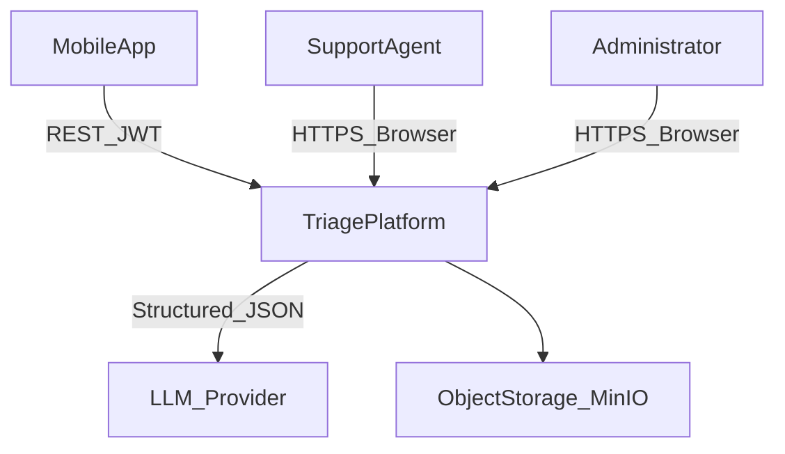
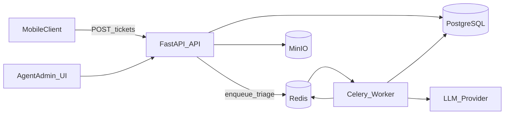
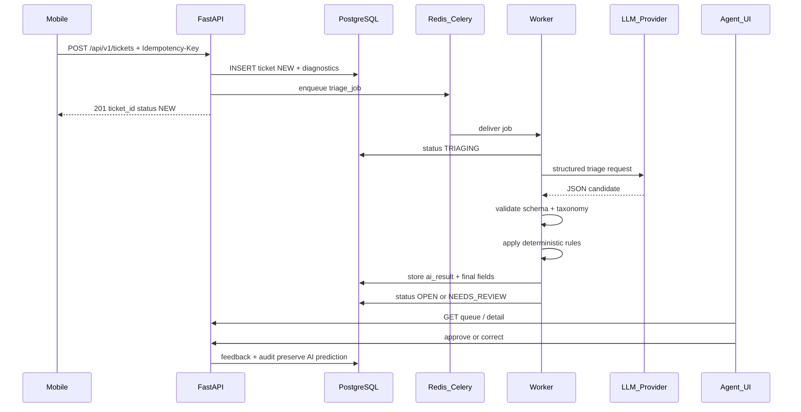

# AI-First Mobile Support Ticket Triage Platform — System Design

**Document version:** 0.1  
**Status:** POC system design  
**Primary consumer:** Coding agents and engineers  
**Last updated:** 2026-10-03  
**Source requirements:** [requirements.md](./requirements.md)  
**Related artifacts:** [data_model.md](./data_model.md), [api_contracts.md](./api_contracts.md), [ui_ux_guidelines.md](./ui_ux_guidelines.md), [quality_assurance.md](./quality_assurance.md)

---

## 1. Purpose and Scope

This document specifies the POC system design for an AI-first support ticket triage platform. End users submit support requests from a mobile application. The platform persists each ticket with approved diagnostic context, asynchronously performs AI triage, and presents structured results to support agents in a web console.

### 1.1 Design Principle (normative)

> **The AI proposes structured decisions; the application validates and governs those decisions; a human can review and override them.**

Consequential actions (refunds, account changes, customer reply send) are never executed by AI in this POC.

### 1.2 Python-first mandate

Prefer Python for application logic, APIs, workers, schemas, rules, tests, and server-rendered UI. Non-Python is limited to:

- browser progressive enhancement (HTMX, Alpine.js, CSS);
- infrastructure runtimes (PostgreSQL, Redis, MinIO, Docker).

### 1.3 In scope / out of scope

In scope matches [requirements.md](./requirements.md) §1.3. Explicit non-goals (§1.4): multi-tenant SaaS, full CRM, omnichannel ingestion, advanced WFM/SLA, autonomous consequential actions, enterprise RBAC, custom model training, large RAG, external CRM integrations, production BI, real-time customer–agent chat.

---

## 2. Technology Stack

| Layer | Choice | Requirement drivers |
|---|---|---|
| HTTP API / web app | **FastAPI** + Pydantic v2 + Jinja2 | FR-TKT-*, §4.1–4.2, NFR-PERF-001/003 |
| Agent/admin UI | **Jinja2 + HTMX + Alpine.js** (served by FastAPI) | FR-QUE-*, FR-DET-*, FR-ADM-* |
| Domain / use cases | Plain Python packages (service layer) | NFR-MNT-001/004, Appendix B |
| Persistence | **SQLAlchemy 2.0** + **Alembic** + **PostgreSQL** | §4.4, NFR-MNT-003, NFR-REL-001 |
| Async jobs | **Celery** + **Redis** | FR-AI-001, §4.5, NFR-REL-002–004 |
| AI integration | Provider-agnostic Python port; default **OpenAI-compatible structured JSON** | FR-AI-003–016, NFR-MNT-002, §4.3 |
| Auth | **JWT** (PyJWT) for mobile + agent/admin; role claim `agent` \| `admin` | NFR-SEC-002/003, §4.7 |
| Attachments | **MinIO** (S3 API) + DB metadata | §4.6 |
| Observability | **structlog** + Prometheus `/metrics` | NFR-OBS-001–003 |
| Packaging | **Docker Compose** (`api`, `worker`, `postgres`, `redis`, `minio`) | POC deployability |
| Tests | **pytest**, httpx, factory fixtures | NFR-MNT-004, AC-001–015 |

---

## 3. Architecture Overview

### 3.1 Context



### 3.2 Containers



### 3.3 Canonical triage sequence



### 3.4 Runtime responsibilities

1. **Ingestion API** — Authenticate mobile client; validate body; enforce idempotency; persist raw ticket + diagnostics as `NEW` before any AI call; enqueue triage; return within p95 ≤ 1s (NFR-PERF-001). AI unavailability must not block create (FR-TKT-003, NFR-AVL-002, AC-003).
2. **Triage worker** — Claim job idempotently; `NEW→TRIAGING`; call LLM via abstraction; validate structured output; apply deterministic rules; persist immutable AI prediction + governed finals; set `OPEN` or `NEEDS_REVIEW`; record latency/tokens/cost; never stick forever in `TRIAGING`.
3. **Agent/admin console** — Queue/filter/search/detail; approve/correct; status transitions; admin taxonomy/teams/rules/thresholds; analytics over reviewed tickets only.
4. **Governance layer** — Controlled taxonomy and teams; confidence thresholds; rule overrides with recorded source; provenance labels (`customer`, `diagnostics`, `ai`, `human`, `rule`).

---

## 4. Logical Package Layout

Documented target layout (implementation follows this design):

```text
apps/
  api/                 # FastAPI routes, deps, Jinja2 templates, static assets
  worker/              # Celery app + triage tasks
packages/
  domain/              # entities, status machine, provenance types
  application/         # use cases: create_ticket, run_triage, review_ticket
  infrastructure/      # SQLAlchemy repos, Celery, LLM adapters, MinIO
  schemas/             # Pydantic API models + AI output schema
```

Dependency rule: `apps` → `application` → `domain`; `infrastructure` implements ports used by `application`. LLM SDKs never appear outside `infrastructure`.

---

## 5. Component Design

### 5.1 Ticket ingestion service

**Owns:** FR-TKT-001–007, AC-001–003, AC-014 (ingestion half).

Behavior:

1. Require `Authorization: Bearer <token>` and `Idempotency-Key`.
2. Validate `message` (required non-empty), optional `subject`, optional `attachments` metadata, optional `diagnostics`.
3. Invalid diagnostic fields produce field-level errors without discarding valid customer text when the request is otherwise acceptable; fully malformed bodies return 422.
4. Look up idempotency key scoped to authenticated principal; on hit, return prior `ticket_id` (AC-002).
5. In one DB transaction: insert `tickets` (`NEW`), `ticket_diagnostics`, attachment metadata rows, `idempotency_keys`, audit `ticket.created`.
6. After commit: enqueue Celery task `triage.process_ticket(ticket_id, job_id)`. Enqueue failure schedules a recoverable retry path (DB `triage_jobs` row in `pending`) so ingestion still succeeds.
7. Response: `{ ticket_id, status: "NEW", created_at }` — no AI fields.

Attachment binaries (if implemented) upload to MinIO via presigned URL or multipart endpoint; DB stores only metadata/object key (§4.6).

### 5.2 Ticket lifecycle / state machine

**Owns:** FR-STA-001–006, FR-AUD-001–002, AC-010.

Allowed statuses: `NEW`, `TRIAGING`, `NEEDS_REVIEW`, `OPEN`, `IN_PROGRESS`, `RESOLVED`, `CLOSED`.

| From | To | Actor |
|---|---|---|
| — | `NEW` | system (create) |
| `NEW` | `TRIAGING` | worker (job start) |
| `TRIAGING` | `OPEN` | worker (success, no review gate) |
| `TRIAGING` | `NEEDS_REVIEW` | worker (low confidence / invalid / failure / contradiction) |
| `NEEDS_REVIEW` | `OPEN` | agent (after review) |
| `OPEN` | `IN_PROGRESS` | agent |
| `IN_PROGRESS` | `RESOLVED` | agent |
| `RESOLVED` | `CLOSED` | agent |
| `OPEN` \| `IN_PROGRESS` | `NEEDS_REVIEW` | agent (optional escalate) |

Every transition writes `audit_events` with `old_status`, `new_status`, `actor_type` (`system` \| `worker` \| `agent` \| `admin`), `actor_id`, timestamp.

### 5.3 Asynchronous triage worker

**Owns:** FR-AI-001–016, FR-PRI-002–004, FR-RTE-003, FR-STA-003–005, NFR-REL-002–004, AC-004–006, AC-008.

Pipeline:

```text
claim job (idempotent)
  → NEW → TRIAGING
  → load ticket, diagnostics, active taxonomy, teams, rules, thresholds
  → LLM.complete(structured schema)
  → validate Pydantic AI schema
  → reject invented category/subcategory/team/priority
  → normalize tags
  → apply deterministic priority/routing rules (may override AI)
  → decide OPEN vs NEEDS_REVIEW
  → persist ai_triage_results (immutable) + ticket_decisions (finals + sources)
  → audit triage.completed | triage.failed
  → mark job succeeded | exhausted
```

**Retry policy (configurable, defaults):** max 3 attempts, exponential backoff with jitter, hard timeout per LLM call. After exhaustion: ticket → `NEEDS_REVIEW`, job `failed`, error recorded (NFR-REL-003).

**Idempotency:** Unique active result per ticket; retries reuse the same `triage_jobs.id`. Re-processing a succeeded job is a no-op (NFR-REL-004).

**Review gates (FR-STA-005):** any of — category/priority/routing confidence below admin threshold; unrecognized/invalid classification after validation retries; contradictory signals (e.g. rule vs AI conflict flagged); terminal triage failure.

### 5.4 AI provider abstraction

**Owns:** NFR-MNT-002, §4.3, NFR-SEC-007, NFR-PRV-004.

```python
class TriageLLMPort(Protocol):
    async def triage(self, request: TriagePromptInput) -> TriageLLMRawResult: ...
```

- Default adapter: OpenAI-compatible chat completions with JSON schema / structured output.
- Config: `AI_PROVIDER`, `AI_MODEL`, `AI_BASE_URL`, `AI_API_KEY` (env/secrets only).
- Prompt places customer text and diagnostics inside clearly delimited untrusted data sections; system instructions forbid following ticket-embedded instructions.
- Only fields needed for triage are sent (NFR-PRV-004).
- Adapter records `provider`, `model`, `prompt_version`, `started_at`, `ended_at`, `token_usage`, `estimated_cost`, `raw_response` (restricted retention).
- Model has **no** DB credentials, tool calls for mutations, or ability to trigger refunds/account actions.

### 5.5 Deterministic rules engine

**Owns:** FR-PRI-002–004, FR-RTE-*, FR-ADM-003, AC-008.

Rules are DB-configured (not hard-coded). Evaluation order: ascending `priority` then `id`. Matchers may reference category, subcategory, diagnostic fields (e.g. `recent_error_codes`, `account_tier`), and keyword predicates on message/subject.

Actions: set `priority` and/or `assigned_team`. On match:

- final value updated;
- `priority_source` / `routing_source` = `rule`;
- rule id stored for audit.

Sentiment alone never escalates to P0/P1 (FR-PRI-004) — enforced in rule validator and AI post-checks.

### 5.6 Agent queue and ticket detail

**Owns:** FR-QUE-001–005, FR-DET-001–007, AC-009, AC-011.

- Queue API/UI columns: ticket ID, summary/subject, priority, category, status, assigned/recommended team, AI confidence indicator, created_at.
- Filters: status, priority, category, team, `needs_review`.
- Search: ticket ID + customer text (`message`/`subject`); optional trigram/index.
- Sort: created_at, priority.
- Detail view separates panels by provenance: customer content, diagnostics, AI analysis (labeled inference), human decisions.
- Agent actions: accept AI, correct fields, edit suggested reply (draft only — not sent), status transitions.

### 5.7 Feedback and evaluation

**Owns:** FR-FBK-001–004, FR-ANL-001–002, AC-007, AC-015.

- `ai_triage_results` is append-only / immutable after success.
- Human edits write `feedback_corrections` rows and update `ticket_decisions` finals; AI columns never overwritten.
- Accept-without-change writes an approval signal.
- Metrics API/export compares AI vs human **only** on reviewed tickets (`reviewed_at IS NOT NULL`). Unreviewed predictions are excluded from accuracy denominators.

### 5.8 Administration

**Owns:** FR-TAX-003, FR-ADM-001–004, FR-RTE-001–002.

Admin-only endpoints/UI for:

- categories/subcategories activate/deactivate/create/edit (referential integrity);
- support teams;
- deterministic rules;
- AI thresholds (`low_confidence_threshold`, retry bounds, model id display).

Seed data: taxonomy from FR-TAX-002; teams `account_support`, `billing_support`, `technical_support`, `product_support`.

### 5.9 Analytics

**Owns:** FR-ANL-001–002, AC-015.

Exposed as backend queries / simple dashboard (not a BI warehouse):

| Metric | Definition |
|---|---|
| Category agreement | reviewed tickets where AI category = final category / reviewed count |
| Subcategory agreement | same for subcategory |
| Priority agreement | same for priority |
| Routing agreement | AI recommended team = final team / reviewed |
| Override rate | reviewed with ≥1 correction / reviewed |
| Low-confidence/review rate | tickets that entered `NEEDS_REVIEW` / triaged |
| AI latency | triage job duration p50/p95 |
| Triage failure rate | terminal failed jobs / jobs attempted |
| Est. cost per ticket | sum(estimated_cost) / tickets with cost metadata |

---

## 6. Requirements → Design Traceability

| Requirement cluster | Design owner |
|---|---|
| FR-TKT-001–007 durable create + idempotency | Ingestion service + `idempotency_keys` |
| FR-STA-001–006 lifecycle | Domain state machine + audit |
| FR-TAX-001–003 controlled taxonomy | DB seed + AI validator + admin API |
| FR-AI-001–016 async structured triage | Celery worker + LLM port + Pydantic schema |
| FR-PRI-001–004 priority + rule override | Rules engine + `priority_source` |
| FR-RTE-001–003 teams | `support_teams` + AI/final assignment columns |
| FR-QUE / FR-DET agent UX | FastAPI + HTMX console |
| FR-FBK feedback preservation | Immutable AI rows + corrections table |
| FR-ADM admin config | Admin routes + `app_config` / `rules` |
| FR-ANL metrics | Analytics queries (reviewed-only) |
| FR-AUD audit | `audit_events` writer on all mutations |
| NFR-PERF ingestion/UI latency | Sync path avoids LLM; indexed list queries |
| NFR-REL durability/retry/idempotent workers | Persist-then-enqueue; Celery + job table |
| NFR-AVL AI degradation | Create succeeds when LLM/Redis flaky |
| NFR-SEC authz/secrets/XSS/injection | JWT roles; env secrets; template escaping; untrusted prompt data |
| NFR-PRV minimization/retention | Diagnostic allowlist; configurable retention fields |
| NFR-OBS logs/metrics/trace | structlog correlation ids; Prometheus |
| NFR-MNT config/migrations/tests | Admin config; Alembic; pytest vs ACs |
| AC-001–015 | See §10 Testing Strategy |

---

## 7. Cross-Cutting Concerns

### 7.1 Authentication and authorization

| Client | Mechanism | Roles |
|---|---|---|
| Mobile | Bearer JWT (app/user POC identity) | `mobile` scope for `POST /tickets` |
| Agent | Session cookie or Bearer JWT | `agent` |
| Admin | Same as agent with elevated claim | `admin` (implies agent read + admin mutations) |

Admin-only mutations (taxonomy, teams, rules, thresholds) reject `agent`-only credentials (AC-012). Unauthenticated protected routes → 401.

### 7.2 Secrets

Loaded from environment / secret manager: `DATABASE_URL`, `REDIS_URL`, `AI_API_KEY`, `JWT_SECRET`, `MINIO_*`. Never committed (AC-013, NFR-SEC-004).

### 7.3 Logging hygiene

Structured JSON logs with `ticket_id`, `triage_job_id`, `request_id`. Do not log JWTs, API keys, or full unnecessary PII dumps (NFR-SEC-006). Prefer IDs for operator traceability (NFR-OBS-003).

### 7.4 Privacy and retention

- Collect only allowlisted diagnostic fields (FR-TKT-004 / NFR-PRV-001).
- Mobile UX must surface diagnostic inclusion (product responsibility; API accepts opt-in flag if provided).
- Tables carry `retain_until` or global `DATA_RETENTION_DAYS` config (NFR-PRV-003); POC default e.g. 180 days.
- Raw LLM payloads stored in restricted column with shorter retention than ticket body.

### 7.5 Transport and storage security

TLS in deployed environments (NFR-SEC-001). PostgreSQL/MinIO encryption at rest via hosting defaults (NFR-SEC-005). MinIO buckets private; no public object ACLs.

### 7.6 Input safety

Pydantic validation at API boundary; Jinja2 autoescape; parameterized SQL; ticket text treated as untrusted in prompts (NFR-SEC-007).

---

## 8. Failure Modes

| Failure | System behavior |
|---|---|
| LLM timeout / 5xx | Bounded retry with backoff; metrics `triage_retries` |
| LLM invalid JSON / schema | Retry; then `NEEDS_REVIEW` + error record (AC-005) |
| Invented taxonomy/team/priority | Reject as invalid AI output; same retry/failure path |
| Low confidence | Persist AI result; status `NEEDS_REVIEW` (AC-006) |
| Redis/Celery unavailable at enqueue | Ticket still committed; job row `pending`; API or sweeper re-enqueues |
| Worker crash mid-job | Celery redelivery; idempotent handler |
| Stuck `TRIAGING` | Watchdog reaps jobs past `triage_timeout`; force `NEEDS_REVIEW` |
| Burst > 10 tickets/s | Ingestion continues; AI queue depth grows; no ticket loss (NFR-PERF-004) |
| AI provider prolonged outage | Ingestion + agent queue remain up; tickets reviewable without AI (AC-003) |

---

## 9. Observability

**Logs:** structlog JSON; correlate `request_id` → `ticket_id` → `triage_job_id`.

**Metrics (Prometheus):**

- `http_request_duration_seconds` (route, status)
- `http_requests_total`
- `tickets_created_total`
- `triage_jobs_started_total` / `succeeded_total` / `failed_total`
- `triage_latency_seconds`
- `triage_retries_total`
- `llm_tokens_total` / `llm_estimated_cost_usd_total`
- `queue_depth` (approx via Redis/Celery inspect or job table counts)

**Traceability:** Operator reconstructs path using IDs in logs + `audit_events` + `triage_jobs` without reading message bodies.

---

## 10. Deployment Topology

Docker Compose services:

| Service | Image/role |
|---|---|
| `api` | uvicorn FastAPI (API + HTMX UI) |
| `worker` | Celery worker (`triage` queue) |
| `beat` (optional) | Celery beat for watchdog/reaper |
| `postgres` | PostgreSQL 16 |
| `redis` | Redis 7 |
| `minio` | MinIO |

Environment variables (names only): `DATABASE_URL`, `REDIS_URL`, `AI_PROVIDER`, `AI_MODEL`, `AI_BASE_URL`, `AI_API_KEY`, `JWT_SECRET`, `MINIO_ENDPOINT`, `MINIO_ACCESS_KEY`, `MINIO_SECRET_KEY`, `MINIO_BUCKET`, `DATA_RETENTION_DAYS`, `LOW_CONFIDENCE_THRESHOLD`, `TRIAGE_MAX_RETRIES`, `TRIAGE_TIMEOUT_SECONDS`, `PROMPT_VERSION`.

Capacity target: ≥ 10,000 tickets stored; burst ≥ 10 creates/s without data loss (NFR-PERF-004).

---

## 11. Testing Strategy

| Acceptance | Test approach |
|---|---|
| AC-001 Create | API integration: POST → GET ticket |
| AC-002 Idempotency | Double POST same key → one row |
| AC-003 AI-independent ingestion | LLM/Redis mocked down; create 201 + visible ticket |
| AC-004 Structured triage | Worker with stub LLM → validated stored fields |
| AC-005 Invalid AI output | Stub returns bad schema → not success final; retry/review |
| AC-006 Low confidence | Confidence below threshold → `NEEDS_REVIEW` |
| AC-007 Override preservation | Correct category; query AI + human both present |
| AC-008 Rule override | Seed rule; assert final priority + `priority_source=rule` |
| AC-009 Queue filters | Seed tickets; filter assertions |
| AC-010 Lifecycle audit | Transition → audit row fields |
| AC-011 AI provenance UI | Detail template contains AI inference labeling |
| AC-012 Security boundaries | 401 unauth; 403 agent on admin mutation |
| AC-013 Secrets | CI grep / gitleaks on repo |
| AC-014 Performance | Locust/k6 smoke on create path; assert no lost acks |
| AC-015 Metrics | Seed reviewed set; analytics endpoint denominators |

Unit tests cover: state machine, tag normalization, rules engine, AI schema validation, confidence gating, sentiment-not-priority invariant.

---

## 12. Recommended Build Order

Mapped from requirements §5.5 to packages:

1. `packages/domain` + SQLAlchemy models + Alembic + seed taxonomy/teams  
2. Ingestion API + idempotency (`apps/api`, `application/create_ticket`)  
3. Lifecycle transitions + audit writer  
4. Celery worker skeleton + `triage_jobs`  
5. LLM port + Pydantic AI schema + OpenAI adapter  
6. Persist AI results, retries, review thresholds, rules engine  
7. Agent queue + detail HTMX UI  
8. Approve/correct + feedback persistence  
9. Admin configuration UI/API  
10. Analytics endpoints + end-to-end AC suite  

---

## 13. Definition of Done (design alignment)

The implementation of this design is complete when the end-to-end scenario in requirements §5.3 succeeds in a Compose-deployed environment, and AC-001–015 pass under automated or documented manual verification.

---

## 14. Supporting Artifacts

- [data_model.md](./data_model.md) — logical ERD, tables, indexes, provenance  
- [api_contracts.md](./api_contracts.md) — REST + AI structured-output contracts  
- [ui_ux_guidelines.md](./ui_ux_guidelines.md) — agent/admin console UX  
- [quality_assurance.md](./quality_assurance.md) — test strategy, AC suite, release gates  
- [sprints.md](./sprints.md) — countable 6-sprint backlog mapped to ACs / FRs  
